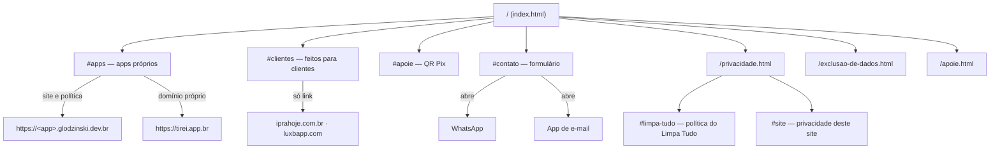

# Visão geral

## Objetivo

Ser o endereço oficial da empresa para:

- apresentar os **apps próprios** e os **projetos feitos para clientes**;
- centralizar as **políticas de privacidade** e a página de **exclusão de dados**
  (URLs exigidas pelas lojas: Google Play e App Store);
- receber **contato** (WhatsApp +55 48 99653-6602 e suporte@glodzinski.dev.br);
- receber **doações via Pix**.

## Mapa do site



## Apps próprios × projetos de clientes

| | Apps próprios | Projetos de clientes |
|---|---|---|
| Exemplos | Tirei!, Combinô, FarmaFigurinha, Limpa Tudo | iPraHoje, LuxB |
| Seção na home | “Nossos aplicativos” | “Também desenvolvemos para outras empresas” |
| Domínio | `<app>.glodzinski.dev.br` (ou próprio, como `tirei.app.br`) | Do cliente |
| Política de privacidade | Listada em `/privacidade.html` | Do cliente (não listada) |
| Suporte pelo formulário | Sim | Não: suporte do cliente |

## Estrutura de arquivos

```text
.
├── index.html, privacidade.html, exclusao-de-dados.html, apoie.html, 404.html
├── style.css                 # tokens da marca + componentes
├── favicon.svg, apple-touch-icon.png
├── CNAME, .nojekyll          # GitHub Pages
├── partials/                 # head, header e footer compartilhados
├── assets/
│   ├── apps/                 # ícones oficiais dos apps (192px)
│   ├── brand/                # logotipo, símbolo, ícone 512, og-image
│   ├── fonts/                # Inter e Inter Tight (self-hosted, OFL)
│   ├── js/main.js            # tema, menu, copiar Pix, formulário
│   └── pix/                  # qr.svg + payload.txt (gerados)
├── scripts/
│   ├── apps.mjs              # catálogo de apps (fonte única)
│   ├── make-logo.cjs         # gera o logotipo a partir da fonte (npm run logo)
│   ├── fonts/                # Inter Tight Bold (.woff) usada pelo gerador do logo
│   ├── build.mjs             # injeta parciais e blocos gerados
│   ├── pix.config.mjs        # chave, nome, cidade, txid
│   ├── pix.mjs               # BR Code (porta do Limpa Tudo)
│   └── gen-pix.mjs           # gera QR + payload
└── docs/
```
