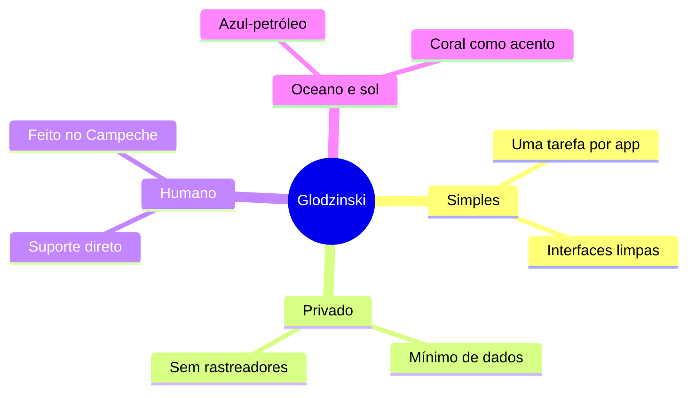

# Identidade visual — Glodzinski Tecnologia

## Conceito

**“Software do Campeche.”** Uma empresa pequena, de Florianópolis, que faz
apps simples e honestos. A marca junta dois elementos do lugar:

- **Oceano** (azul-petróleo): confiança, calma, tecnologia sem frieza;
- **Pôr do sol** (coral): o toque humano, usado com parcimônia, como um acento.

Referências de estilo: produtos “tech tool” limpos (Linear, Vercel, Raycast),
com mais calor e personalidade local.

## Logo

| Arquivo | Uso |
|---|---|
| `assets/brand/logo-mark.svg` | Símbolo: ícone de app, favicon, avatar de redes |
| `assets/brand/logo-mark-mono.svg` | Símbolo monocromático (`currentColor`), para carimbos e fundos de foto |
| `assets/brand/logo-full.svg` | Símbolo + wordmark, fundo claro |
| `assets/brand/logo-full-dark.svg` | Símbolo + wordmark, fundo escuro |
| `assets/brand/logo-mark-512.png` | PNG para lojas, perfis, documentos |
| `assets/brand/og-image.png` (+ `.svg`) | Imagem de compartilhamento (1200×630) |

**Símbolo:** um **G** de traço único e arredondado, como uma onda que fecha e
volta para dentro, num quadrado de cantos suaves (raio 16/64) com gradiente
oceano. O **ponto coral** no alto é o sol nascendo no Campeche e também o
“ponto” de um cursor: o momento em que algo começa.

**Wordmark:** `glodzinski` em minúsculas, Space Grotesk Bold, tracking −0,6;
abaixo, `TECNOLOGIA` em caixa alta, peso 500, tracking largo (≈ 0,25em), cor oceano.

**Regras:**

- Área de proteção: no mínimo ¼ da largura do símbolo em todos os lados.
- Tamanho mínimo: símbolo com 16 px; logo completo com 120 px de largura.
- Não distorcer, girar, trocar as cores do gradiente, contornar o símbolo ou
  colocar o ponto coral em outra posição.
- Sobre fotos ou fundos coloridos, use o símbolo monocromático em branco.

Os textos dos SVGs usam a fonte Space Grotesk. Para peças fora da web
(impressão, Figma), instale a fonte ou converta o texto em contornos.

## Cores

### Marca

| Nome | Hex | Uso |
|---|---|---|
| **Oceano** | `#0E7C86` | Cor principal: botões, links, destaques |
| **Oceano profundo** | `#0B5563` | Hover, início do gradiente |
| **Lagoa** | `#14A3A8` | Fim do gradiente do símbolo |
| **Coral** (pôr do sol) | `#FF7A59` | Acento decorativo: ponto do logo, marcadores, brilhos. **Nunca em texto.** |
| **Tinta** | `#0B1B2B` | Texto principal no claro |
| **Areia** | `#FBFAF7` | Fundo no claro |

Gradiente oficial: `linear-gradient(135deg, #14A3A8 → #0B5563)` no símbolo; nos
blocos de destaque, `#0B5563 → #0E7C86 → #14A3A8`.

### Tokens do site (claro e escuro)

| Token | Claro | Escuro | Uso |
|---|---|---|---|
| `--bg` | `#FBFAF7` | `#071318` | Fundo da página |
| `--surface` | `#FFFFFF` | `#0D1F26` | Cards, seções alternadas |
| `--surface-2` | `#F3F1EC` | `#132A33` | Hover, chips |
| `--border` | `#E5E1D8` | `#1F3A44` | Bordas e divisórias |
| `--text` | `#0B1B2B` | `#EAF2F3` | Texto principal |
| `--muted` | `#55606E` | `#9AB0B6` | Texto secundário |
| `--brand` | `#0E7C86` | `#5FD3D3` | Ações, links |
| `--brand-strong` | `#0B5563` | `#8BE3E0` | Hover |
| `--brand-soft` | `#DDF3F2` | `#0F3B40` | Fundo de ícones |
| `--on-brand` | `#FFFFFF` | `#04211F` | Texto sobre `--brand` |

**Contraste (WCAG AA):** Oceano `#0E7C86` sobre Areia ≈ 4,7:1, e texto branco
sobre Oceano ≈ 4,9:1, ambos OK para texto normal. O coral não tem contraste
suficiente para texto e por isso é só decorativo.

### Cores dos apps

Cada app mantém a identidade própria. No site, aparecem num ícone com
gradiente e iniciais, definido em `scripts/apps.mjs` (`colors`).

## Tipografia

| Papel | Fonte | Pesos | Observação |
|---|---|---|---|
| Títulos e wordmark | **Space Grotesk** | 500–700 | Geométrica, técnica e amigável; tracking −0,02em |
| Texto e interface | **Inter** | 400–600 | Legível em tamanhos pequenos |
| Código (Pix copia e cola) | `ui-monospace` | 500 | Fonte do sistema |

Ambas sob licença SIL OFL, **servidas pelo próprio site** (`assets/fonts/`), sem
Google Fonts, para não enviar o IP do visitante a terceiros.

Escala: H1 `clamp(2.1rem, 5.5vw, 3.6rem)`, H2 `clamp(1.6rem, 3.5vw, 2.2rem)`,
corpo 16px/1.65. O “eyebrow” (rótulo acima dos títulos) usa caixa alta, 0,78rem,
tracking 0,14em, cor oceano e um ponto coral.

## Formas e componentes

- **Raios:** 16px em cards, 10px em campos, 999px (pílula) em botões e chips,
  24px nos blocos de destaque.
- **Sombra:** suave e longa (`0 8px 24px -12px`), nunca dura.
- **Ícones:** traço de 2px, cantos arredondados (estilo Lucide), desenhados em SVG inline.
- **Movimento:** entrada sutil (fade + 12px) ao rolar; respeita
  `prefers-reduced-motion`.
- **Ondas:** motivo gráfico opcional (veja `og-image.svg`) para peças de divulgação.

## Voz e tom

- **Direta e próxima:** “Fale com a gente”, não “Entre em contato conosco”.
- **Honesta sobre dados:** dizer o que coleta e por quê, sem juridiquês
  quando não for preciso.
- **Sem pressão:** doação é “qualquer valor ajuda”; nunca culpa ou urgência.
- **Local sem exagero:** “Feito no Campeche, Florianópolis” no rodapé basta.

Assinatura: **“Apps simples para o dia a dia.”**
