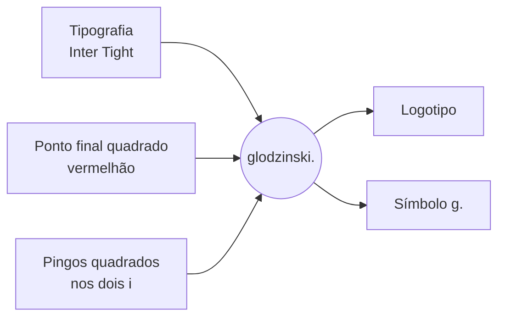

# Identidade visual — Glodzinski Tecnologia

> Versão 2 (23/11/2026). A v1 (símbolo "G" com gradiente azul-petróleo e ponto
> coral) foi descartada: lembrava o logo do Google e o site tinha aparência de
> template genérico.

## Conceito

**Uma empresa de software pequena e séria.** A marca é tipográfica e
contida, para não competir com os produtos. Quem traz a cor são os ícones dos
apps; a marca da empresa fica em preto e branco, com um único detalhe de cor.

Referências: estúdios de software e editoras independentes. Sites com
tipografia forte, listas bem alinhadas, fios finos e quase nenhum ornamento.

## Logotipo

`glodzinski.`, todo em minúsculas, em **Inter Tight Bold** convertida em
contornos. Tem dois detalhes próprios:

1. **Pingos quadrados** nos dois "i", no lugar dos redondos da fonte.
2. **Ponto final quadrado em vermelhão**, como o fim de uma frase: a empresa
   diz o que faz e para por aí. O quadrado também lembra um pixel ou um cursor.

O nome vem sem "Tecnologia": o logotipo é a marca, e a razão social aparece
por extenso onde for necessário (rodapé, documentos).

## Símbolo

O **"g." minúsculo** com o ponto quadrado, num quadrado preto. É usado como
favicon, avatar e ícone, onde o logotipo inteiro não cabe.

Ele foi pensado para se afastar do Google: "g" minúsculo de dois andares em
vez de "G" maiúsculo circular, uma cor só em vez de quatro, ponto quadrado
e não redondo.

## Arquivos

| Arquivo | Uso |
|---|---|
| `assets/brand/logo.svg` | Logotipo sobre fundo claro (preto + vermelhão) |
| `assets/brand/logo-white.svg` | Logotipo sobre fundo escuro ou foto |
| `assets/brand/logo-mono.svg` | Uma cor só (`currentColor`): carimbo, gravação, fax |
| `assets/brand/mark.svg` | Símbolo: quadrado preto, "g" branco, ponto vermelhão |
| `assets/brand/mark-light.svg` | Símbolo em fundo branco |
| `assets/brand/mark-mono.svg` | Símbolo sem fundo, uma cor |
| `assets/brand/mark-512.png` | Perfis, lojas, documentos |
| `favicon.svg`, `apple-touch-icon.png` | Navegador e atalho no iOS |
| `assets/brand/og-image.png` | Prévia em links compartilhados (1200×630) |

Todos os SVGs são gerados por `npm run logo` (`scripts/make-logo.cjs`), a partir
de `scripts/fonts/intertight-700.woff`. Para ajustar espaçamento, tamanho do
ponto ou cores, edite o script e rode de novo. Não edite os SVGs à mão.

No site, o logotipo é inserido inline pelo build: as letras usam
`currentColor` e o ponto usa `var(--accent)`, então o logotipo acompanha o
tema claro ou escuro.

## Regras de uso

- **Área de proteção:** a altura do "g" em volta do logotipo.
- **Tamanho mínimo:** logotipo com 72px de largura; símbolo com 16px.
- **O ponto é sempre quadrado e vermelhão** (ou da mesma cor do texto, na
  versão monocromática). Não troque por círculo, não mude de cor.
- Não aplique gradiente, sombra, contorno ou outra fonte.
- Não use "Glodzinski Tecnologia" ao lado do logotipo como se fosse parte dele.

## Cores

A paleta é neutra de propósito.

| Nome | Claro | Escuro | Uso |
|---|---|---|---|
| **Tinta** | `#111316` | `#ECECEA` | Texto, logotipo, botão principal |
| **Papel** | `#FFFFFF` | `#0F1012` | Fundo |
| **Superfície** | `#F6F6F4` | `#17181B` | Blocos de destaque, notas |
| **Fio** | `#E4E4E0` | `#26282C` | Linhas e bordas |
| **Cinza** | `#5E636B` | `#A0A4AB` | Texto secundário |
| **Cinza claro** | `#6E737B` | `#80848B` | Legendas, metadados |
| **Vermelhão** | `#C93F1B` | `#FF6A3D` | Ponto do logo, erros, foco, detalhes pontuais |

Tokens no CSS: `--text`, `--bg`, `--surface`, `--line`, `--line-strong`,
`--muted`, `--faint`, `--accent`, `--btn-bg`, `--btn-fg`.

**Contraste (WCAG AA, texto normal ≥ 4,5:1):** Tinta/Papel ≈ 18:1;
Cinza/Papel ≈ 6:1; Cinza claro/Papel ≈ 4,7:1; Vermelhão/Papel ≈ 5:1.

**Vermelhão com parcimônia:** aparece no ponto do logo, no sublinhado do
item ativo do menu, nos números dos passos, no foco do teclado e nos
erros. Não use em botões, fundos ou títulos.

## Tipografia

| Papel | Fonte | Peso | Detalhes |
|---|---|---|---|
| Logotipo | Inter Tight | 700 | Em contornos (SVG) |
| Títulos | Inter Tight | 600 | tracking −0,012em (H1 −0,018em), entrelinha 1,08–1,1 |
| Texto e interface | Inter | 400–500 | 16px / 1,6, alternativas `cv11` e `ss01` |
| Código (Pix) | Monoespaçada do sistema | 400 | |

As duas fontes (SIL OFL) são servidas pelo próprio site (`assets/fonts/`),
sem Google Fonts.

Escala: H1 `clamp(2.25rem, 5vw, 3.5rem)`; H2 `clamp(1.5rem, 2.6vw, 2rem)`;
H3 1,125rem; legendas 0,8125rem.

## Layout e componentes

- **Grade:** largura máxima de 1120px, margens de 16px (celular) e 32px (desktop).
- **Seções:** começam com um **fio preto de 1px** e o título à esquerda, com a
  descrição numa segunda coluna, à direita. Esse padrão editorial substitui
  os rótulos coloridos e os cards.
- **Listas em vez de cards:** os apps aparecem em linhas separadas por fios,
  com ícone, nome, categoria e plataformas, descrição e links.
- **Ícones dos apps:** sempre o ícone oficial, com cantos de 22,5% (como no
  iOS) e um contorno interno sutil, para ícones claros não sumirem no fundo
  branco.
- **Botões:** cantos de 8px (não pílula), 44px de altura. O principal é
  preenchido com a cor Tinta; o secundário tem só contorno. Links de ação
  usam uma seta "→".
- **Campos:** cantos de 8px e borda Fio; no foco, a borda vira Tinta.
- **Sem:** gradientes, brilhos, sombras decorativas, emojis, animações de
  entrada ou ícones ilustrativos genéricos.

## Voz e tom

- **Factual e direta.** "Desenvolvemos aplicativos para celular, web e
  computador", e não "Transformamos ideias em experiências".
- **Primeira pessoa do plural**, sem superlativos.
- **Transparente sobre dados:** dizer o que coleta, por que e como apagar.
- **Doações sem pressão:** "o valor é livre", "doar não libera recursos extras".

Assinatura: **"Apps que resolvem uma coisa de cada vez."** (EN: "Apps that
solve one thing at a time." · ES: "Apps que resuelven una cosa a la vez.").
Retoma o princípio da seção A empresa ("preferimos apps que fazem uma coisa
bem feita").

O site não mostra cidade, bairro nem endereço: a empresa se identifica pela
razão social e pelo CNPJ. (A cidade só aparece dentro do código Pix, onde é
campo obrigatório do padrão.)
