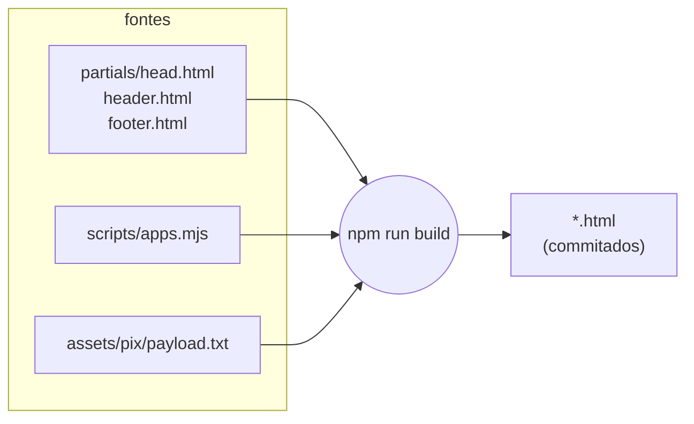
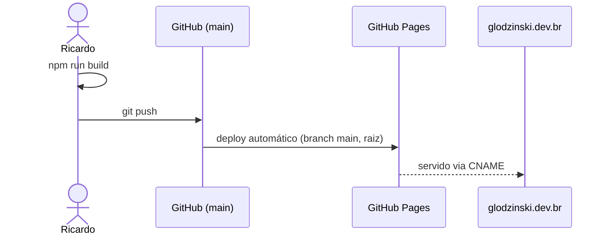

# Site: build, conteúdo e publicação

## Princípios

- **Estático e sem framework:** HTML/CSS/JS puros, carregamento instantâneo,
  nada para atualizar.
- **Visual sóbrio:** layout editorial (listas com fios finos), sem gradientes,
  sombras decorativas ou animações; a cor vem dos ícones dos apps.
- **Sem rastreamento:** sem cookies, analytics nem recursos de terceiros
  (as fontes são locais).
- **Funciona sem JavaScript:** o JS só adiciona tema, menu mobile, copiar Pix
  e o formulário. O conteúdo é HTML puro.
- **Tema claro/escuro:** segue o sistema; o botão salva a escolha no
  `localStorage` (com try/catch).

## Como o build funciona

Não há bundler. O `scripts/build.mjs` **reescreve as próprias páginas**,
trocando o conteúdo entre marcadores:

| Marcador | Origem | Páginas |
|---|---|---|
| `<!-- @head -->` | `partials/head.html` | todas |
| `<!-- @header -->` | `partials/header.html` (+ `aria-current` na página atual) | todas |
| `<!-- @footer -->` | `partials/footer.html` | todas |
| `<!-- @hero-apps -->` | `APPS` (ícones no topo) | index |
| `<!-- @apps -->` | `APPS` em `scripts/apps.mjs` | index |
| `<!-- @clients -->` | `CLIENT_PROJECTS` | index |
| `<!-- @app-options -->` | `APPS` (select do formulário) | index |
| `<!-- @policies -->` | `APPS` (links de política) | privacidade |
| `<!-- @deletion -->` | `APPS` (instruções de exclusão) | exclusao-de-dados |
| `<code class="pix-code">` | `assets/pix/payload.txt` | index, apoie |

Não edite o conteúdo entre os marcadores: ele é sobrescrito no build. O HTML
gerado é commitado, então o GitHub Pages serve tudo sem precisar de CI.

## Tarefas comuns

### Adicionar um app próprio

1. Coloque o ícone oficial do app em `assets/apps/<slug>.png` (quadrado, 192×192,
   sem cantos arredondados; o CSS arredonda).
2. Acrescente um item em `APPS` (`scripts/apps.mjs`): `slug`, `name`, `icon`, `tag`,
   `platforms` (opcional), `description`, `privacyPath` e, enquanto o subdomínio
   não existir, `live: false` + `fallback`. Se o app tiver domínio próprio, use `ownDomain`.
3. `npm run build`.
4. Confira em `npm run dev` e faça commit.

### Adicionar um projeto de cliente

Acrescente em `CLIENT_PROJECTS` (`name`, `icon`, `tag`, `description`, `site`) e rode `npm run build`. Não entra em política nem no
formulário de contato.

### Mudar menu ou rodapé

Edite `partials/` e rode `npm run build`.

## Publicação

- O GitHub Pages publica a raiz da branch `main`. O `.nojekyll` desliga o
  Jekyll, então `docs/` e `scripts/` são servidos como arquivos estáticos,
  sem processamento.
- Links são absolutos a partir da raiz (`/style.css`), o que exige o domínio
  próprio (`CNAME`). Em `rglodzinski.github.io/glodzinski-site/` eles quebrariam.
- `404.html` é usado automaticamente pelo Pages.

## Checklist antes de publicar

- [ ] `npm run build` sem erros
- [ ] Testar no celular (menu, formulário abrindo o WhatsApp)
- [ ] Testar o Pix com o app de um banco (QR e copia e cola)
- [ ] Alternar o tema claro/escuro
