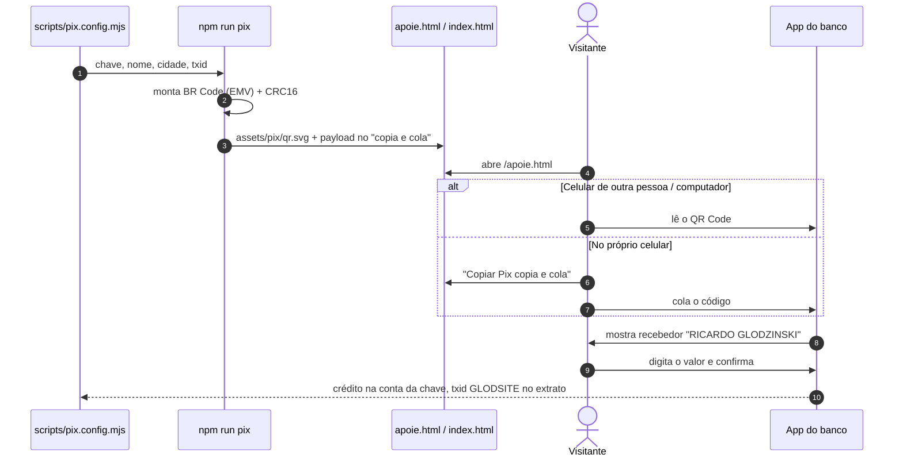
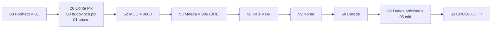

# Doações via Pix

Implementação **igual à do Limpa Tudo** (`LimpaTudo/src/lib/pix.ts`):
um **BR Code Pix estático, sem valor definido**. Quem paga escolhe quanto
enviar, sem intermediário, sem taxa e sem API de banco.

A diferença está no momento em que o código é gerado. No app, o QR é
desenhado em tempo de execução. Aqui ele é gerado **uma vez, no build**
(`npm run pix`), e o site serve um `qr.svg` fixo. O navegador do visitante
não roda nenhum código de Pix.

## Fluxo

## Configuração

`scripts/pix.config.mjs`:

| Campo | Valor | Observação |
|---|---|---|
| `key` | `04765662900` | Mesma chave do Limpa Tudo (CPF) |
| `merchantName` | `Ricardo Glodzinski` | Vira `RICARDO GLODZINSKI` (máx. 25, ASCII maiúsculo) |
| `merchantCity` | `Florianopolis` | Máx. 15 caracteres |
| `txId` | `GLODSITE` | Mostra no extrato que a doação veio do site |

Depois de mudar: `npm run pix` (gera o QR e roda o build) e commit de
`assets/pix/` e dos HTML.

> ⚠️ **A chave é um CPF e fica pública** (no QR e no repositório, que é público),
> como no Limpa Tudo. O `docs/10-monetizacao.md` do Limpa Tudo recomenda usar uma
> **chave aleatória ou o CNPJ** numa conta separada. Para trocar, basta mudar `key`
> (e `merchantName` para `Glodzinski Tecnologia`, se for a conta PJ) e rodar `npm run pix`.

## Estrutura do payload (EMV)

Cada campo é `ID (2) + tamanho (2) + valor`. Não há o campo `54` (valor), por
isso o pagador digita quanto quiser. O CRC é CRC16-CCITT-FALSE (polinômio
`0x1021`, início `0xFFFF`), validado com o vetor de teste `123456789 → 29B1`.

## Atribuição sem rastreamento

Seguindo o plano do Limpa Tudo, cada origem usa um `txid` diferente e o
extrato mostra de onde veio a doação:

| Origem | txid |
|---|---|
| Site institucional | `GLODSITE` |
| Limpa Tudo (app) | `***` (padrão; sugestão do plano: `LTAPP`) |

## Regras de loja

Um QR de Pix ou link de doação **dentro de apps da App Store** (fora dos EUA)
viola a regra 3.1.1. Nos apps iOS, gorjeta só por compra no app (IAP).
Este site está fora da loja e não tem essa restrição, mas **não coloque link
para `/apoie.html` dentro de apps iOS**.
