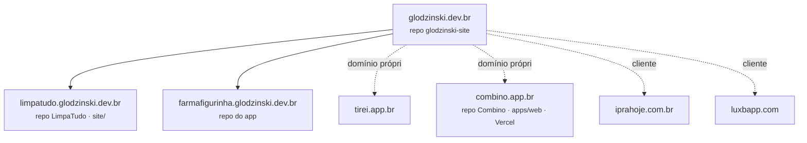
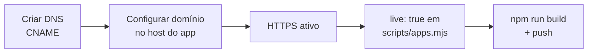

# Subdomínios dos apps

## Padrão

Cada app próprio tem seu site em **`https://<slug>.glodzinski.dev.br`**,
**publicado a partir do repositório do próprio app**. Cada app versiona seu
site junto com o código, as notas de versão e a política de privacidade. O
site institucional só aponta para lá.

**Por que no repositório do app?**

- O site muda junto com o app (features, changelog, downloads, política).
- Cada app escolhe sua stack (o Limpa Tudo usa gerador próprio em `site/`;
  o Combinô, um build estático em `apps/web`, na Vercel).
- O institucional fica pequeno e estável.

**Exceções:**

- **Domínio próprio:** o Tirei! fica em `tirei.app.br` e o Combinô em
  `combino.app.br` (`ownDomain` em `scripts/apps.mjs`).
- **Projetos de clientes** (iPraHoje, LuxB): não usam o domínio da Glodzinski
  e aparecem só como link para o site do cliente.

## Situação (23/11/2026)

| App | Subdomínio planejado | DNS | Endereço atual (`fallback`) |
|---|---|---|---|
| Limpa Tudo | `limpatudo.glodzinski.dev.br` | ✅ no ar (HTTPS) | — (`live: true`; política em `/privacidade.html#limpa-tudo`) |
| FarmaFigurinha | `farmafigurinha.glodzinski.dev.br` | ⏳ | `auracopa26.app` |
| Tirei! | — (domínio próprio) | ✅ | `tirei.app.br` |
| Combinô | — (domínio próprio) | ⏳ DNS no Registro.br | `combino.app.br` (Vercel; `combino-web.vercel.app` continua respondendo) |

## Como ativar um subdomínio

1. **DNS** (no provedor de `glodzinski.dev.br`), conforme o host:
   - GitHub Pages: `CNAME limpatudo → rglodzinski.github.io.`
   - Vercel (subdomínio): `CNAME <slug> → cname.vercel-dns.com.`
2. **Host do app:**
   - GitHub Pages: arquivo `CNAME` com `limpatudo.glodzinski.dev.br` no artefato
     publicado (no Limpa Tudo, via `SITE_URL` no `pages.yml`) e “Enforce HTTPS”;
   - Vercel: Settings › Domains › adicionar o subdomínio.
3. **Política no caminho certo:** o app deve servir a política em `privacyPath`
   (ex.: `/privacidade`).
4. **Aqui:** em `scripts/apps.mjs`, trocar `live: false` por `true`, rodar
   `npm run build` e fazer commit. Os links da home, da página de privacidade e
   da exclusão de dados passam a usar o subdomínio.
5. **Endereço antigo:** se o app estiver nas lojas, atualize a URL da política
   na Play Console e no App Store Connect, e mantenha o endereço antigo
   redirecionando por um tempo.
