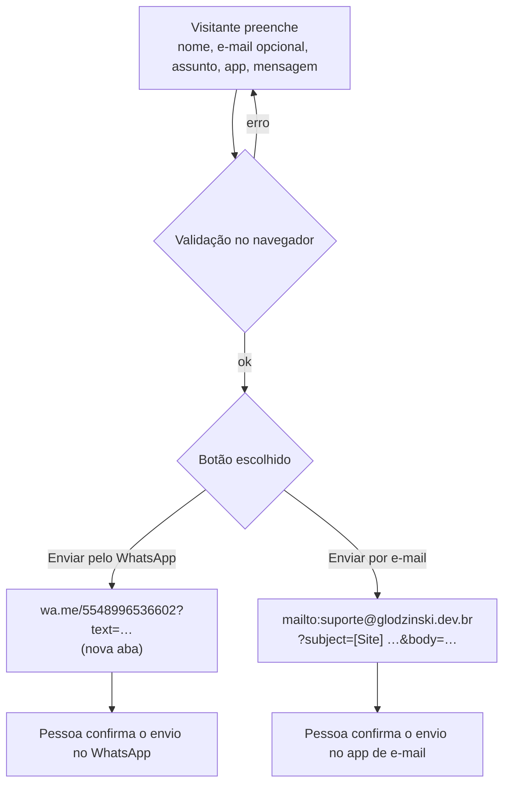

# Contato e privacidade

## Formulário de contato

O site é estático e não tem servidor. O formulário **só monta a mensagem** e
abre o canal que a pessoa escolher. Nada é enviado ou armazenado pelo site.

- Telefone/WhatsApp: **+55 (48) 99653-6602** (`data-phone` no `<form>`, e
  também no rodapé e na página de privacidade).
- Atalhos por URL: `/?app=Combinô#contato` e
  `/?assunto=Privacidade%20e%20dados#contato` pré-selecionam os campos. Os
  links “Suporte” dos cards e a página de exclusão já usam isso, e os apps
  podem usar também.
- Assunto do e-mail: `[Site] <assunto> — <app>`, fácil de filtrar.

**Se um dia quiser receber direto na caixa de entrada** (sem depender do
WhatsApp/app de e-mail do visitante): Web3Forms ou Formspree, com um `fetch`
no `submit`. Nesse caso, atualize a seção “Este site” da política, porque
passa a haver um operador de dados.

## Privacidade e LGPD

| Página | Conteúdo |
|---|---|
| `/privacidade.html#apps` | Índice das políticas dos apps próprios (gerado de `apps.mjs`) |
| `/privacidade.html#limpa-tudo` | Política do Limpa Tudo (processamento 100% local) |
| `/privacidade.html#site` | Este site: sem cookies/analytics; formulário; Pix; GitHub Pages |
| `/privacidade.html#direitos` | Direitos do titular, contato do encarregado, prazo, ANPD |
| `/exclusao-de-dados.html` | Como pedir exclusão (URL exigida pela Google Play) |

**URLs para as lojas:**

- Política de privacidade: a do próprio app (subdomínio) ou
  `https://glodzinski.dev.br/privacidade.html#<app>`.
- Exclusão de conta (Google Play › Segurança dos dados):
  `https://glodzinski.dev.br/exclusao-de-dados.html`.

**Projetos de clientes** (iPraHoje, LuxB): a empresa cliente é a controladora.
Não listamos as políticas deles como nossas; o site só informa que cada um
tem política e processo de exclusão próprios.

**Pendências:**

- Instruções específicas de exclusão por app (ex.: “Perfil › Excluir conta”):
  preencher o campo `deletion` de cada app em `apps.mjs` depois de confirmar
  no app. Hoje só o Limpa Tudo tem texto específico.
- Revisão jurídica dos textos de privacidade.
